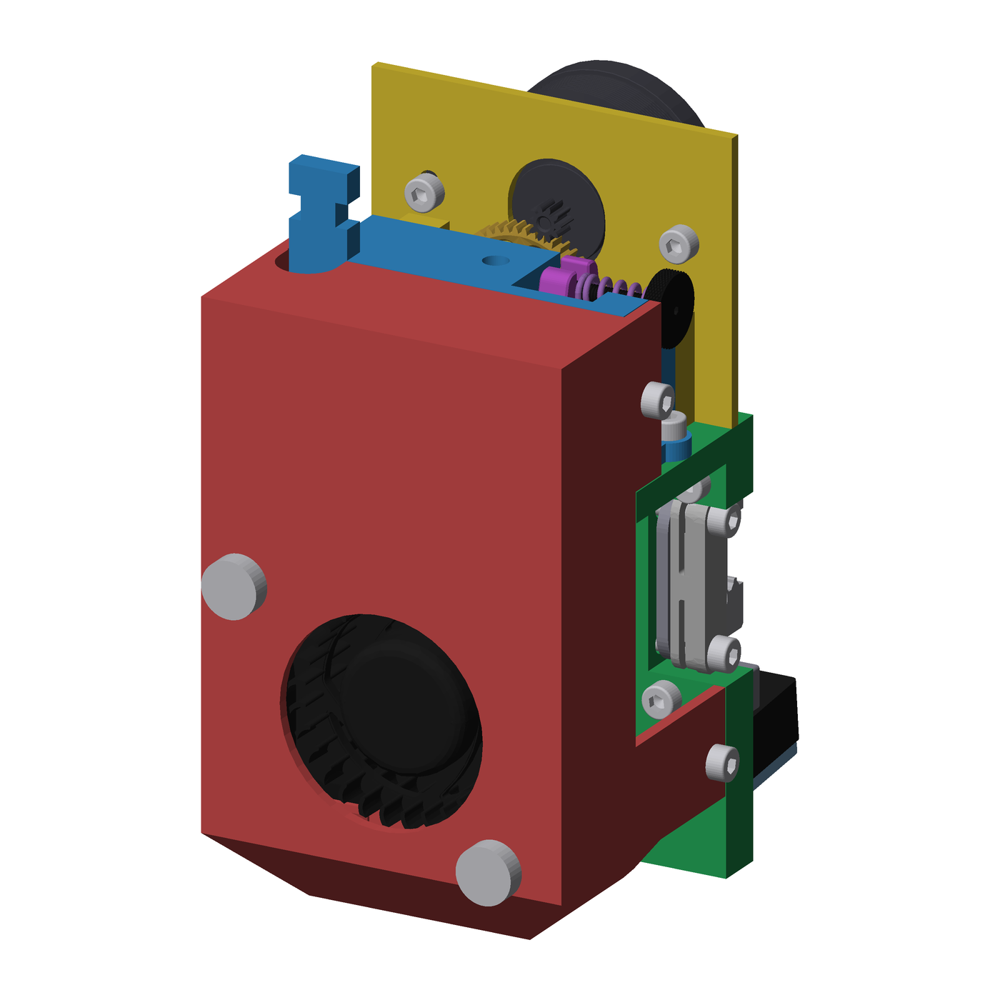
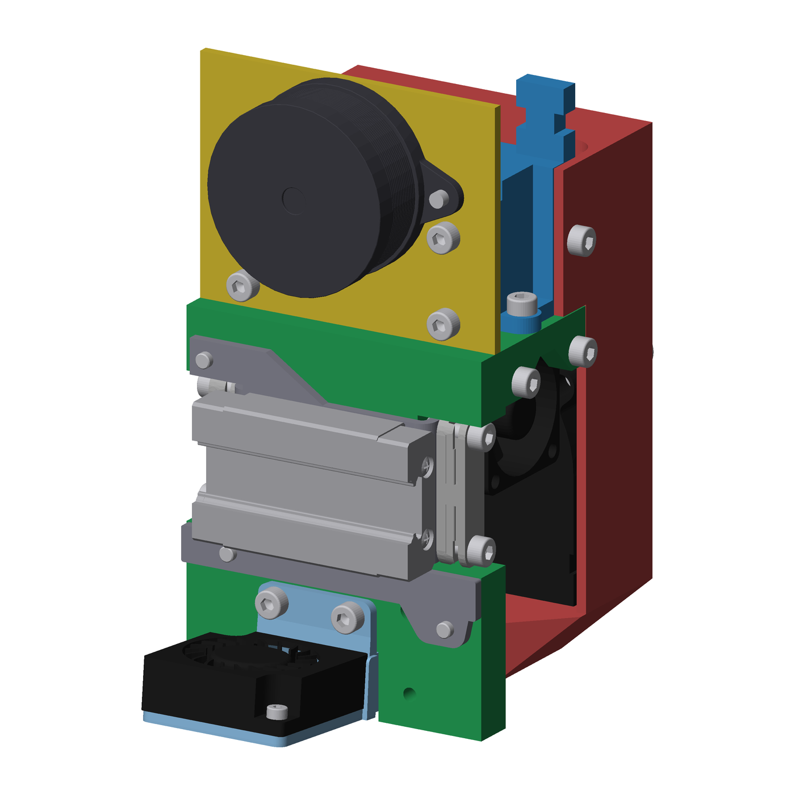

# SV08 toolhead: Sherpa Mini + Goliath

Conversion of the Sovol SV08 toolhead to a Sherpa Mini extruder (Annex) with an air-cooled
Mellow/VzBoT Goliath hotend, modelled in [build123d](https://github.com/gumyr/build123d).
Printed parts are designed for FDM in ASA.

The nozzle stays at its original position. The Sherpa keeps its own gears and drive geometry and is
driven by an LDO 36STH17 with a 10 tooth pinion. The original SV08 parts (carriage interface, Eddy probe,
fans, PCBs) are reused.

<p align="center">
  
  
</p>

Colours: green main body with Goliath carrier, blue PCB holder, yellow motor plate, red fan duct / front cover,
orange Goliath, purple/black Sherpa parts, grey original SV08 parts.

## Setup

```sh
git submodule update --init      # SV08, Sherpa Mini and Goliath source models in ext/
uv sync
```

## Usage

```sh
.venv/bin/python render.py        # printable parts + out/assembly.step
.venv/bin/python render.py --image  # also the README images docs/toolhead_*.png (about 2 min)
.venv/bin/python check.py         # collision check (exit code 1 on collisions)
```

`out/` is generated and not tracked.

## Printed parts

| File (out/)                | Part        | Print orientation           |
|----------------------------|-------------|-----------------------------|
| `extruder_body_sherpa.step`| main body with Goliath carrier and fan wedges | back side on the bed |
| `pcb_holder.step`          | PCB holder with front bearing seat, idler pin seat and filament guides | flat, inside up |
| `motor_plate.step`         | motor plate with rear bearing seat and rear idler pin seat | flat |
| `fan_duct.step`            | 5020 part cooling duct with front cover and lid | front wall on the bed |

## Hardware

| Qty | Part | Where |
|----:|------|-------|
| 11 | heat-set insert M3x5x4 (hole Ø4 x 6.7) | 4 posts, 2 lugs (carrier), 1 PCB holder + 1 carrier (PCBs), 2 PCB holder sides + 1 main body front (fan duct) |
| 1 | heat-set insert M3x5x4 | idler thumbscrew (as in the Sherpa) |
| 4 | M3x12 DIN 912 | motor plate to PCB holder |
| 5 | M3x6 DIN 912 | 2 motor, 3 fan duct (from the sides) |
| 2 | M3x8 DIN 912 | PCB holder lugs to main body |
| 2 | M3x12 | 2515 fan (cuts into the fan holes) |
| 4 | M2.5x5 DIN 912 | Goliath |
| 2 | ST4.8x16 DIN 7981 (self-tapping, pan head) | 5020 fan to the fan duct |
| 1 | cable tie | cables to the bar on the PCB holder |

The Sherpa parts (gears, bearings, shafts, idler arm, thumbscrew, spring) are used as in the original.

## Assembly (short guide)

1. **Print** the four parts from `out/` in ASA, orientation as in the table above.
2. **Heat-set inserts:** 4 into the posts of the PCB holder (from the motor side), 1 into the PCB holder front
   (upper PCB screw), 2 into the sides of the PCB holder (fan duct), 1 into the thumbscrew holder; in the main
   body 2 from the top into the carrier (lugs, flush with the top), 1 into the carrier front (lower PCB screw) and 1 from the right
   into the block on the front face (fan duct).
3. **Goliath:** into the carrier from below, 4x M2.5x5 from the top. **2515 fan:** onto the wedges at the
   left, 2x M3x12 from the outside.
4. **Main body to the carriage** with the original screws, as the SV08 install plate (do this before the
   housing goes on, the carriage screws are hidden afterwards).
5. **Sherpa:** front bearing, drive shaft with drive gear, idler arm with idler gear, pin and spring into the
   PCB holder, thumbscrew from the right. Put the motor plate with the rear bearing on the posts, 4x M3x12
   from the motor side.
6. **Motor:** 2x M3x6 from the front through the motor plate. The left hole is a slot: set the mesh of
   pinion and 50t gear, then tighten.
7. **Housing to the main body:** 2x M3x8 from the top through the lugs.
8. **PCBs** onto the PCB holder / carrier with the original shoulder screws.
9. **Fan duct:** 5020 fan from the inside against the front wall, 2x ST4.8x16 from the front. Lead the cables
   up through the hole in the lid and fix them to the bar with a cable tie. Slide the duct on from the front,
   3x M3x6 from the sides (left and right into the PCB holder, right bar into the main body).
10. **Firmware:** extruder for the Sherpa Mini (`gear_ratio: 50:10`, `rotation_distance` about 22.68,
    calibrate), Goliath thermistor and heater as per Mellow; run PID tuning.

## Code

Every part is a class whose `solid` is built on first access (`functools.cached_property`), so importing a
module is cheap. Each module ends with one ready instance (`SHERPA`, `GOLIATH_CARRIER`, `HOUSING`,
`PCB_HOLDER`, `MOTOR_PLATE`, `MAIN_BODY`, `FAN_DUCT`, `FASTENERS`, `TOOLHEAD`).

| Module | Content |
|--------|---------|
| `geometry.py` | value types (`XZ`, `XY`, `Span`, `Boss`, `Rect`) and primitive builders (`cylinder_along_y`, `box_between`, ...) |
| `common.py` | paths, filament axis, SV08 STEP loader, list of dropped SV08 parts |
| `sherpa.py` | `Sherpa`: Sherpa parts placed in SV08 coordinates (one rigid transformation) |
| `goliath_carrier.py` | `GoliathCarrier`: plate below the housing, Goliath placement, 2515 fan wedges |
| `housing.py` | `HousingLayout` (shared axes, posts, clearances), `PcbHolder`, `FilamentGuides`, `MotorPlate` |
| `fan_duct.py` | `FanDuct`: 5020 part cooling duct combined with the front cover |
| `main_body.py` | `MainBody`: block with holes and pockets, fused with the carrier |
| `fasteners.py` | `Fasteners`: screws and heat-set inserts (models from the SV08 and Sherpa STEPs) |
| `assembly.py` | `Toolhead`: placed parts and the named, coloured STEP tree |
| `render.py`, `check.py` | entry points (`render.py` also has a small z-buffer renderer for the README images) |

Coordinates are those of the Sovol STEP assembly (mm): X to the right, Y to the back, Z up, seen from
the front of the printer.
